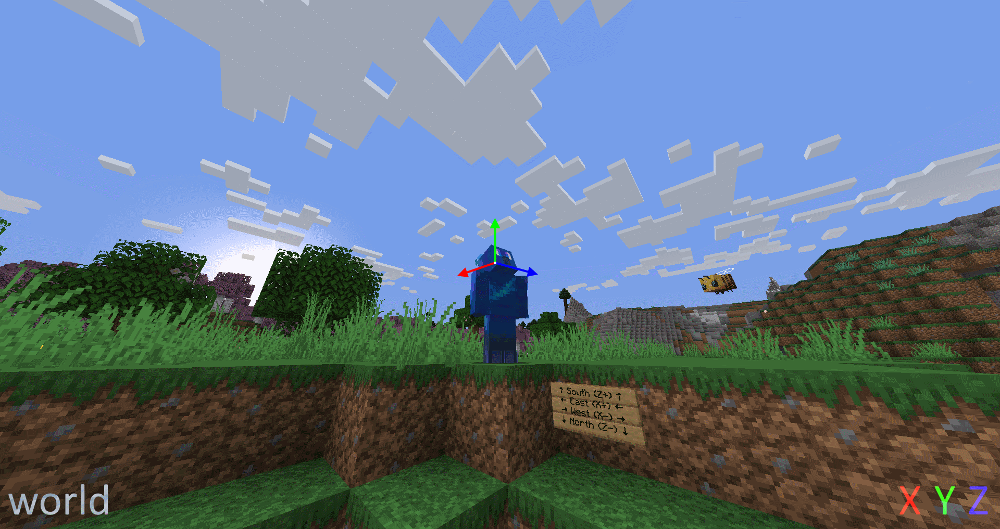

#   Space

A [string][string] that determines how a 3-vector is transformed for an entity.

### Values

Value | Description
------|------------
`world` | The axes are not transformed and is relative to the world's coordinates where X points to the west/east (negative/positive), Y points to the bottom/top (negative/positive), and the Z points to the north/south. (negative/positive)
`local` | The axes are transformed to be relative to the entity's orientation where X points to its left, Y points upwards relative to where the entity is facing, and Z points to where the entity is facing.
`local_horizontal` | Same as `local` except it considers the vertical orientation to be zero, resulting in Z being projected *(flattened out)* onto the horizontal plane, making it shorter. X and Y also become shorter by the same amount and Y will always point upwards.  The axes shrink as the direction the entity is facing diverges from being horizontal. *(e.g: if the entity is looking straight up/down, the axes will have zero length, akin to forcing the X, Y, and Z to be zero)*
`local_horizontal_normalized` | Same as `local_horizontal` except the axes are normalized, where the axes' length are set back to its previous length of 1 if it's of a non-zero length.
`velocity` | The axes are transformed to be relative to the entity's velocity, similar to `local`. If the velocity is purely vertical, the direction the entity is facing is used to determine the direction of X and Y instead of the velocity.  The axes scale based on how fast the entity is moving. *(e.g: if the entity is not moving, the axes will have zero length, akin to forcing the X, Y, and Z to be zero)*
`velocity_normalized` | Same as `velocity` except the vertical velocity is considered to be 0.
`velocity_horizontal_normalized` | Same as `velocity_horizontal` except the axes are normalized, where the axes' length are set back to its previous length of 1 if it's of a non-zero length.

